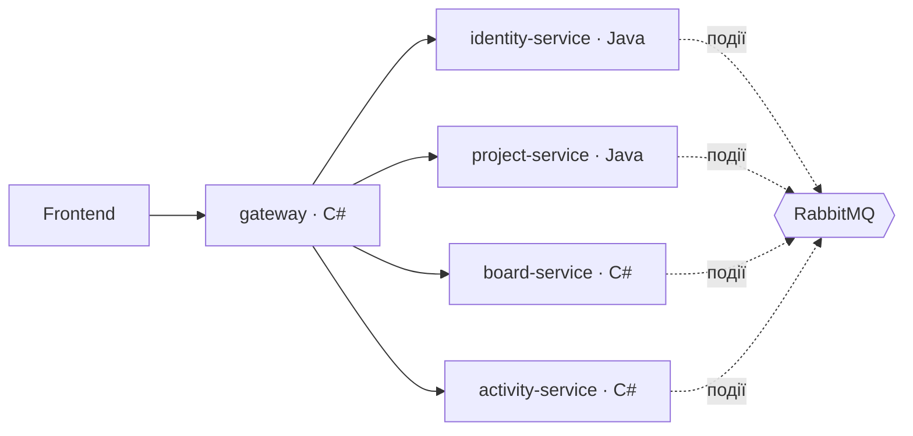

# ProjectHub

> Робоча назва. Змініть, коли придумаєте кращу.

Платформа для студентів-розробників: викладаєш проєкт, збираєш команду, ведеш задачі на вбудованій дошці, а твій реальний внесок автоматично з'являється в портфоліо.

## Можливості MVP

- **Вхід через GitHub** — без окремої реєстрації, репозиторії підтягуються одразу.
- **Навчальні заклади** — проєкти живуть усередині закладу. Вступ до закладу: через пошту з доменом закладу або за схваленням викладача/адміна.
- **Проєкти** — опис, стек, посилання на репозиторій і на чат команди (Telegram/Discord), ролі «шукаємо» (frontend, QA, дизайнер…).
- **Ліміти** — не більше 3 власних проєктів і не більше 5 проєктів, до яких приєднався.
- **Вбудована канбан-дошка** в кожному проєкті: оновлення в реальному часі, коментарі до карток.
- **Портфоліо з доказами** — «закрив 12 задач у проєкті X, роль frontend», а не просто посилання.
- **Автостатус** — проєкт без руху 30 днів стає неактивним і опускається в пошуку.
- **Пошук** по всіх проєктах платформи і фільтр усередині закладу.

Свідомо **без** чату й особистих повідомлень.

## Архітектура коротко



| Сервіс | Мова | Власник | Порт | За що відповідає |
|---|---|---|---|---|
| `gateway` | C# · .NET 10, YARP | C#-розробник | 8080 | Єдина точка входу, маршрутизація, перевірка JWT, CORS, rate limiting |
| `identity-service` | Java · Spring Boot 4 | Java-розробник | 8081 | Вхід через GitHub, користувачі, профілі, видача JWT |
| `project-service` | Java · Spring Boot 4 | Java-розробник | 8082 | Заклади, проєкти, учасники, заявки, ліміти, пошук |
| `board-service` | C# · ASP.NET Core, SignalR | C#-розробник | 8083 | Канбан-дошки, картки, коментарі, realtime |
| `activity-service` | C# · ASP.NET Core, Dapper | C#-розробник | 8084 | Внесок, портфоліо, стрічка подій, автостатус проєктів |

Детально — [docs/ARCHITECTURE.md](docs/ARCHITECTURE.md).

## Стек

- **C#:** .NET 10 (LTS), ASP.NET Core, YARP, SignalR, EF Core, Dapper, RabbitMQ.Client, xUnit
- **Java:** Java 21 (LTS), Spring Boot 4, Spring Security (OAuth2 Client + Resource Server), Spring Data JPA, Spring AMQP, Flyway, JUnit 5
- **Інфраструктура:** PostgreSQL 17, RabbitMQ 4, Mailpit (тестова пошта), Docker Compose, GitHub Actions
- **Тести з реальною БД:** Testcontainers (є і для Java, і для .NET)
- **Frontend:** вирішимо пізніше. Бекенд одразу описує API через OpenAPI.

Чому .NET 10, а не 8 чи 9: підтримка .NET 8 і .NET 9 закінчується 10 листопада 2026 року, а .NET 10 — LTS до листопада 2028.

## Швидкий старт

Потрібно: Git, Docker Desktop, JDK 21, .NET 10 SDK.

```bash
cp .env.example .env
docker compose up -d
```

| Що | Адреса |
|---|---|
| PostgreSQL | `localhost:5433` (не 5432, щоб не конфліктувати з локально встановленим PostgreSQL) |
| RabbitMQ, панель керування | http://localhost:15672 |
| Mailpit, тестова пошта | http://localhost:8025 |

Сервіси поки запускаються з IDE: IntelliJ IDEA для Java, Rider / Visual Studio / VS Code для C#. У Docker вони переїдуть у Спринті 5 (задача SH-06).

Скрипт `infra/postgres/init.sql` виконується тільки на порожній базі. Якщо ви його змінили: `docker compose down -v && docker compose up -d` (локальні дані видаляться).

## Документація

| Файл | Що всередині |
|---|---|
| [ARCHITECTURE.md](docs/ARCHITECTURE.md) | Схема, межі сервісів, чому C# тут, а Java там, автентифікація |
| [API.md](docs/API.md) | REST-ендпоінти всіх сервісів і маршрути gateway |
| [EVENTS.md](docs/EVENTS.md) | Контракти подій RabbitMQ |
| [DATABASE.md](docs/DATABASE.md) | Таблиці кожної бази |
| [ROADMAP.md](docs/ROADMAP.md) | Спринти і що показуємо в кінці кожного |
| [TASKS-JAVA.md](docs/TASKS-JAVA.md) | Задачі Java-розробника |
| [TASKS-CSHARP.md](docs/TASKS-CSHARP.md) | Задачі C#-розробника |
| [TASKS-SHARED.md](docs/TASKS-SHARED.md) | Спільні задачі |
| [CONVENTIONS.md](docs/CONVENTIONS.md) | Гілки, коміти, PR, іменування, порти, змінні середовища |

## Як ми працюємо

1. Задачі з `docs/TASKS-*.md` переносимо в GitHub Issues (одна задача — один issue) і ведемо на дошці GitHub Projects. Поки своєї дошки немає, користуємось гітхабівською і заодно вивчаємо головного конкурента зсередини.
2. Одна задача = одна гілка = один Pull Request.
3. Кожен PR рев'ює **інший** учасник. Java-розробник читає C#, C#-розробник читає Java, і обидва розуміють систему цілком.
4. Контракти (API, події) змінюємо тільки разом: спершу правка в `docs/`, потім код.

## Ментор

Ментор проєкту — Claude.

- **Перед задачею:** напишіть ID задачі й свій план. Ментор поправить план до того, як ви витратите час на код.
- **Після задачі:** скиньте посилання на PR (репозиторій можна підключити до чату, щоб ментор читав код) або вставте код. Отримаєте рев'ю.
- **Наприкінці спринту:** коротко — що зроблено, що заблоковано, чого навчились. План коригується під ваш реальний темп.

## Команда

| Роль | Ім'я | GitHub |
|---|---|---|
| Java-розробник (identity, project) | Spider (М.Д.І)| |
| C#-розробник (gateway, board, activity) | | |
